# Alumnos · Estadísticas visuales

Capturas locales con datos sintéticos. Ningún alumno, nota ni cuenta real. Comparación contra main 0088b83.

351 tests aprobados. 56 estados revisados en Chrome: 375/1280 px, claro/oscuro, texto 100%/200%; sección, sin notas, un solo período, sin sección, 36 alumnos y modo ejemplo.

## Antes y después

### 375-claro

| Antes | Después |
|---|---|
| 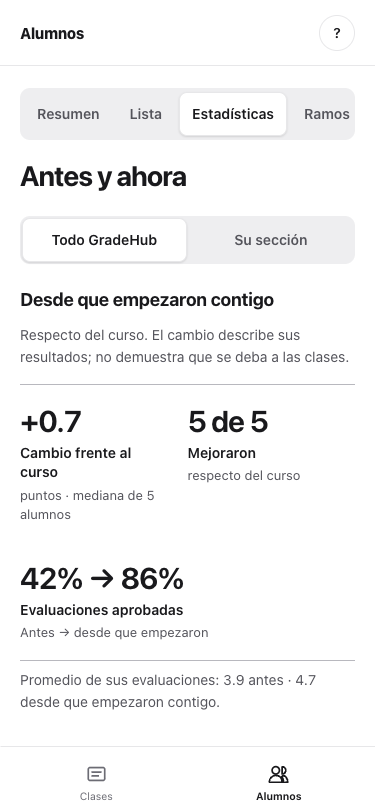 | 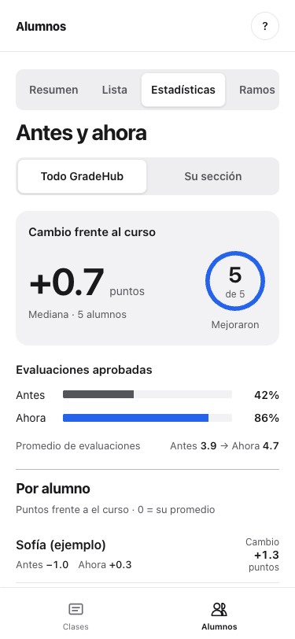 |

### 375-claro-texto200

| Antes | Después |
|---|---|
| 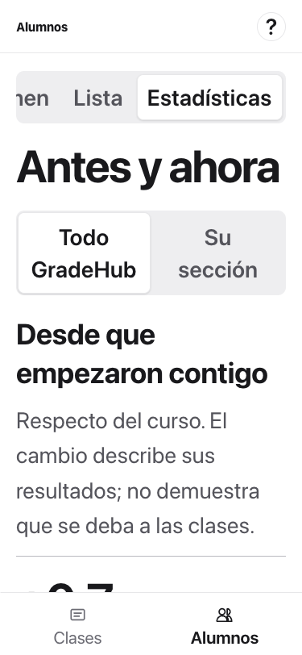 |  |

### 375-oscuro

| Antes | Después |
|---|---|
| 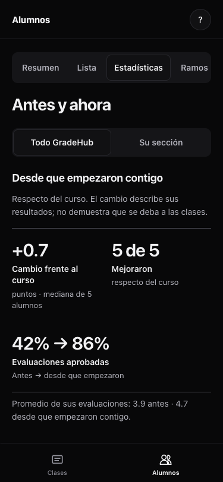 | 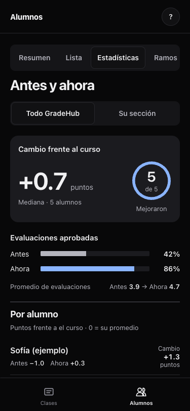 |

### 375-oscuro-texto200

| Antes | Después |
|---|---|
| 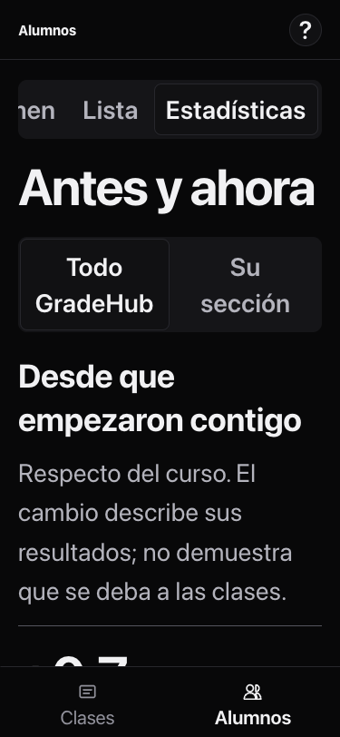 |  |

### 1280-claro

| Antes | Después |
|---|---|
|  | 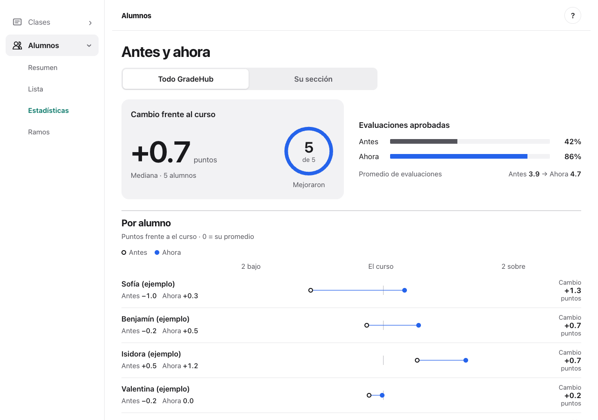 |

### 1280-claro-texto200

| Antes | Después |
|---|---|
|  | 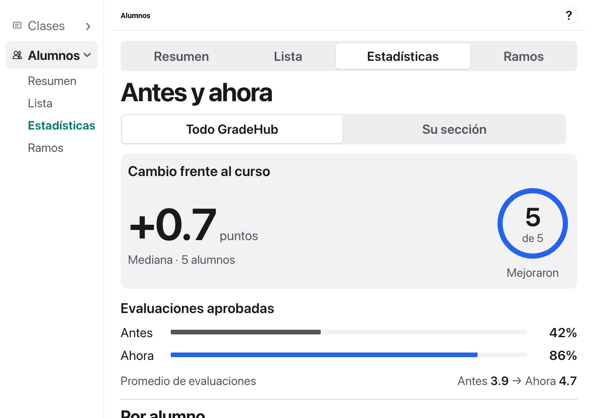 |

### 1280-oscuro

| Antes | Después |
|---|---|
| 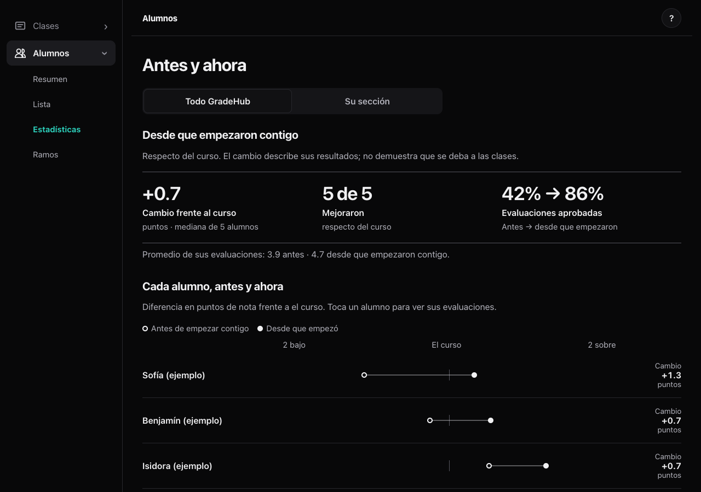 | 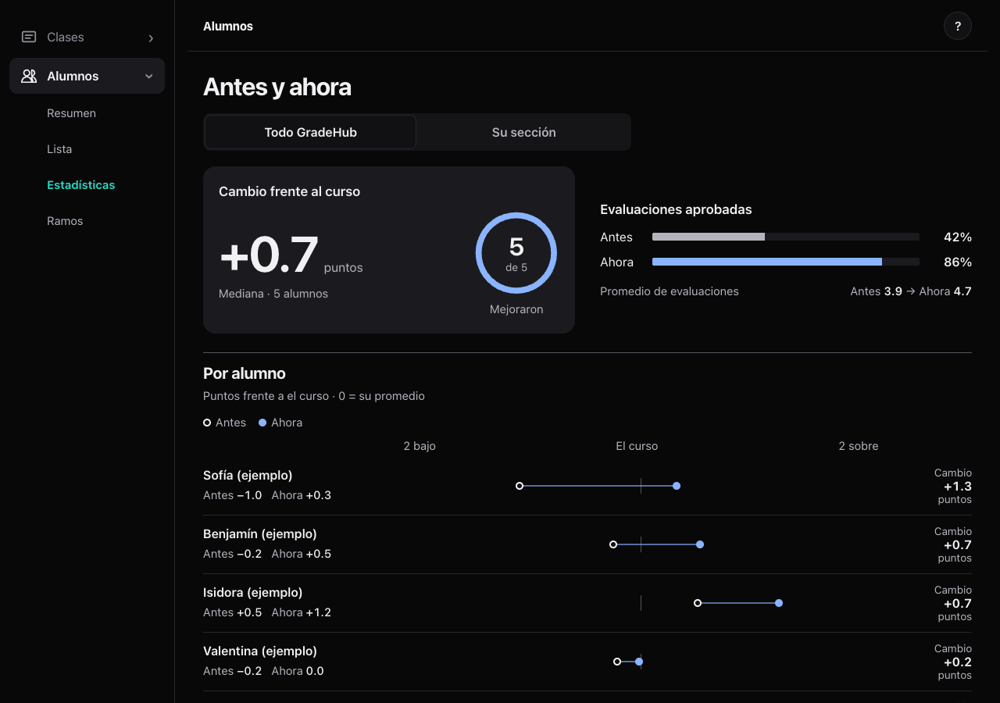 |

### 1280-oscuro-texto200

| Antes | Después |
|---|---|
| 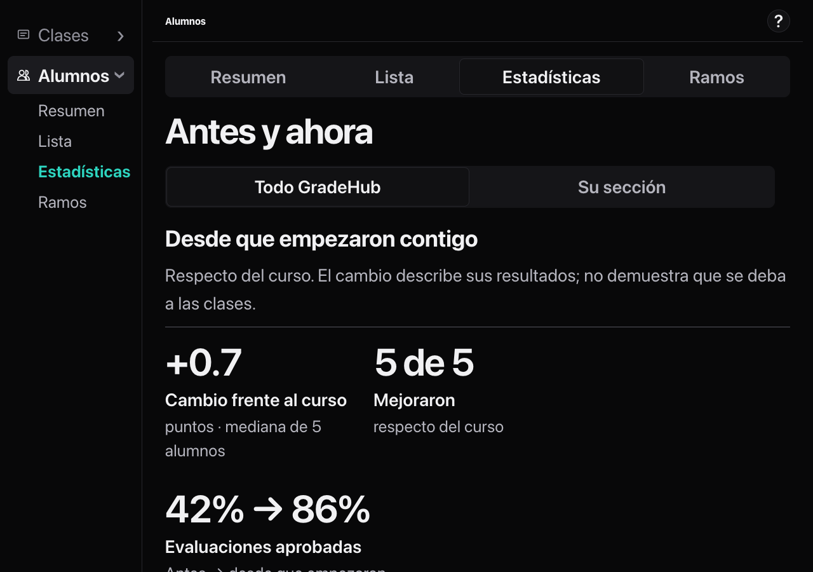 | 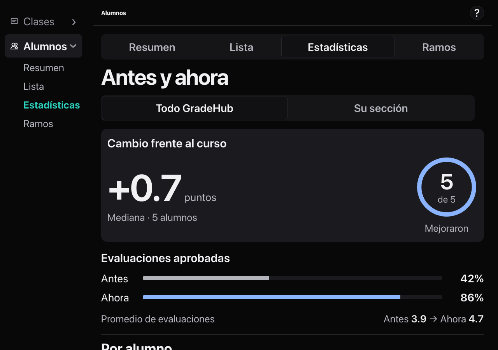 |

## Estados adicionales

- [1280-claro-ejemplo](1280-claro-ejemplo.png)
- [1280-claro-muchos](1280-claro-muchos.png)
- [1280-claro-seccion](1280-claro-seccion.png)
- [1280-claro-sin-notas](1280-claro-sin-notas.png)
- [1280-claro-sin-seccion](1280-claro-sin-seccion.png)
- [1280-claro-texto200-ejemplo](1280-claro-texto200-ejemplo.png)
- [1280-claro-texto200-muchos](1280-claro-texto200-muchos.png)
- [1280-claro-texto200-seccion](1280-claro-texto200-seccion.png)
- [1280-claro-texto200-sin-notas](1280-claro-texto200-sin-notas.png)
- [1280-claro-texto200-sin-seccion](1280-claro-texto200-sin-seccion.png)
- [1280-oscuro-ejemplo](1280-oscuro-ejemplo.png)
- [1280-oscuro-muchos](1280-oscuro-muchos.png)
- [1280-oscuro-seccion](1280-oscuro-seccion.png)
- [1280-oscuro-sin-notas](1280-oscuro-sin-notas.png)
- [1280-oscuro-sin-seccion](1280-oscuro-sin-seccion.png)
- [1280-oscuro-texto200-ejemplo](1280-oscuro-texto200-ejemplo.png)
- [1280-oscuro-texto200-muchos](1280-oscuro-texto200-muchos.png)
- [1280-oscuro-texto200-seccion](1280-oscuro-texto200-seccion.png)
- [1280-oscuro-texto200-sin-notas](1280-oscuro-texto200-sin-notas.png)
- [1280-oscuro-texto200-sin-seccion](1280-oscuro-texto200-sin-seccion.png)
- [375-claro-ejemplo](375-claro-ejemplo.png)
- [375-claro-metodo](375-claro-metodo.png)
- [375-claro-muchos](375-claro-muchos.png)
- [375-claro-seccion](375-claro-seccion.png)
- [375-claro-sin-notas](375-claro-sin-notas.png)
- [375-claro-sin-seccion](375-claro-sin-seccion.png)
- [375-claro-texto200-ejemplo](375-claro-texto200-ejemplo.png)
- [375-claro-texto200-muchos](375-claro-texto200-muchos.png)
- [375-claro-texto200-seccion](375-claro-texto200-seccion.png)
- [375-claro-texto200-sin-notas](375-claro-texto200-sin-notas.png)
- [375-claro-texto200-sin-seccion](375-claro-texto200-sin-seccion.png)
- [375-oscuro-ejemplo](375-oscuro-ejemplo.png)
- [375-oscuro-metodo](375-oscuro-metodo.png)
- [375-oscuro-muchos](375-oscuro-muchos.png)
- [375-oscuro-seccion](375-oscuro-seccion.png)
- [375-oscuro-sin-notas](375-oscuro-sin-notas.png)
- [375-oscuro-sin-seccion](375-oscuro-sin-seccion.png)
- [375-oscuro-texto200-ejemplo](375-oscuro-texto200-ejemplo.png)
- [375-oscuro-texto200-muchos](375-oscuro-texto200-muchos.png)
- [375-oscuro-texto200-seccion](375-oscuro-texto200-seccion.png)
- [375-oscuro-texto200-sin-notas](375-oscuro-texto200-sin-notas.png)
- [375-oscuro-texto200-sin-seccion](375-oscuro-texto200-sin-seccion.png)
