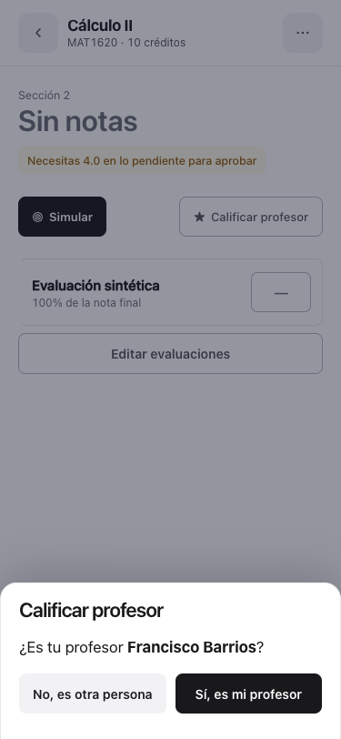
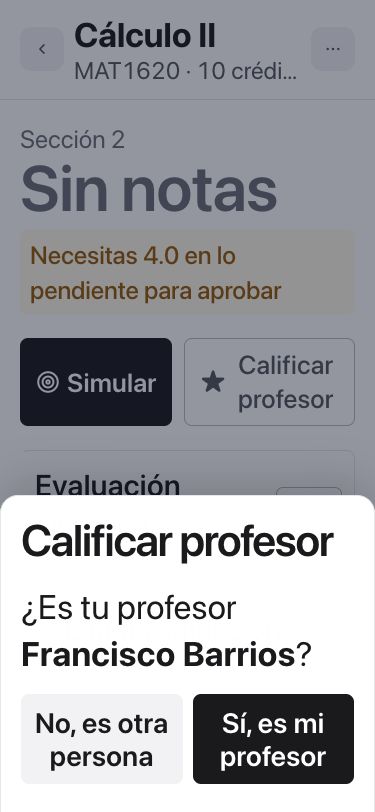
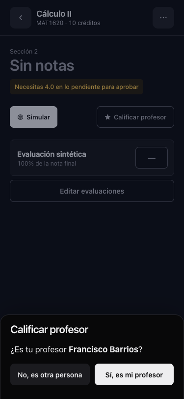
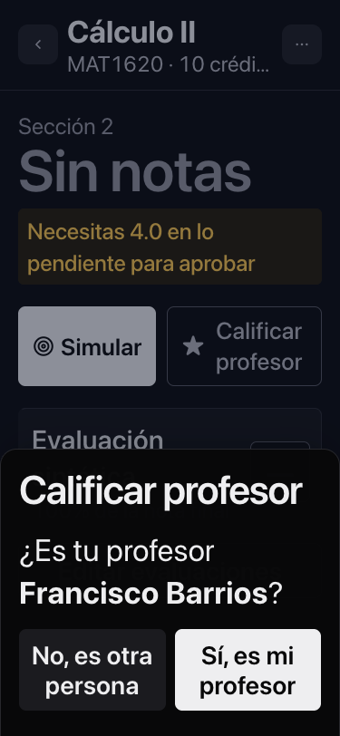
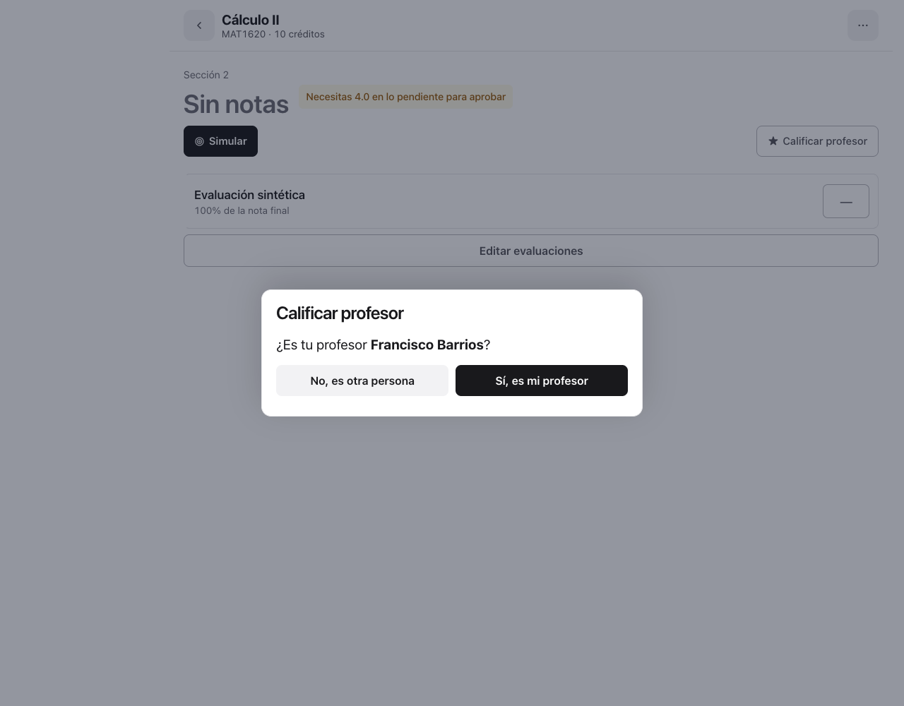
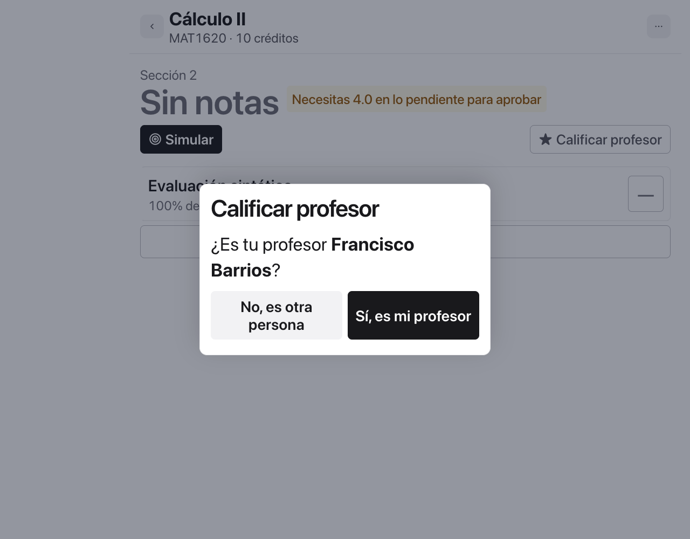
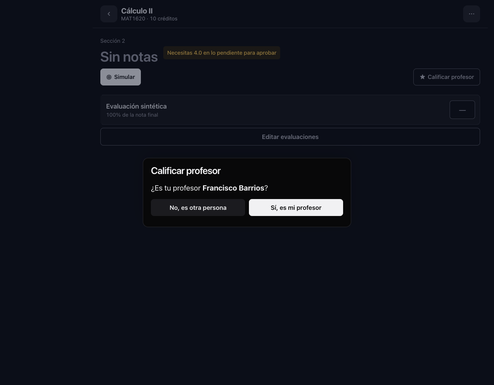
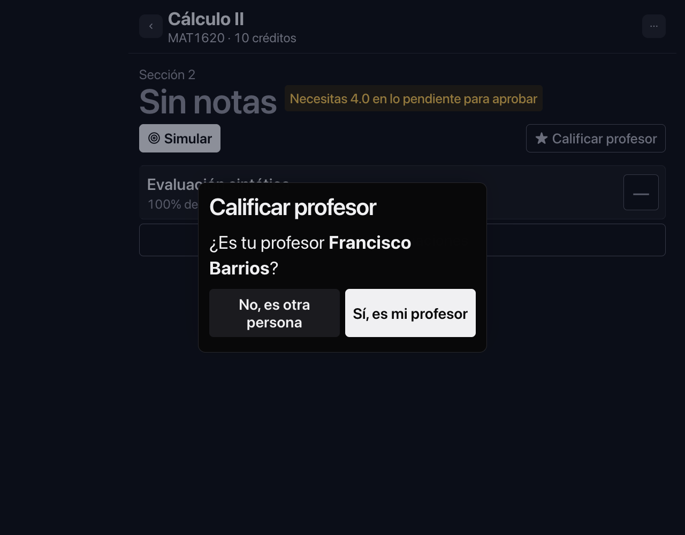

# Confirmar docente desde BuscaCursos

Cuenta, ramos y notas sintéticos. Los docentes propuestos vienen de la oferta pública UC 2026-2. Conexiones externas y service worker bloqueados durante la prueba.

## 375 px · claro

## 375 px · claro · texto 200%

## 375 px · oscuro

## 375 px · oscuro · texto 200%

## 1280 px · claro

## 1280 px · claro · texto 200%

## 1280 px · oscuro

## 1280 px · oscuro · texto 200%

Se verificaron Sí/No, foco, controles de 44 px, ausencia de desbordes y de escrituras previas, y JSON académico intacto. Resultados en checks.json.
