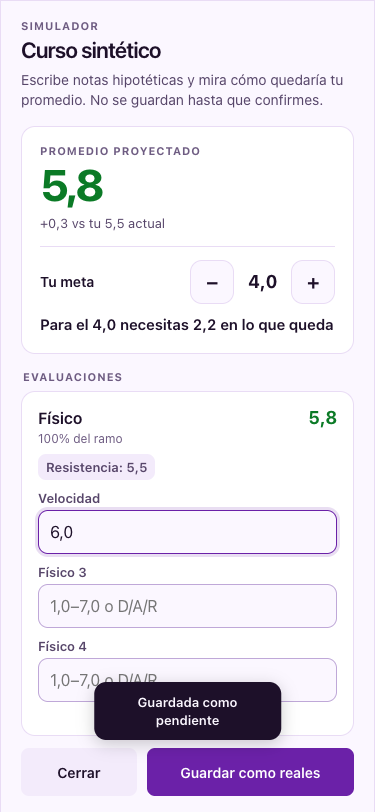
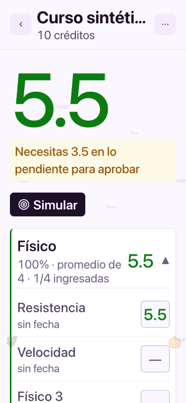
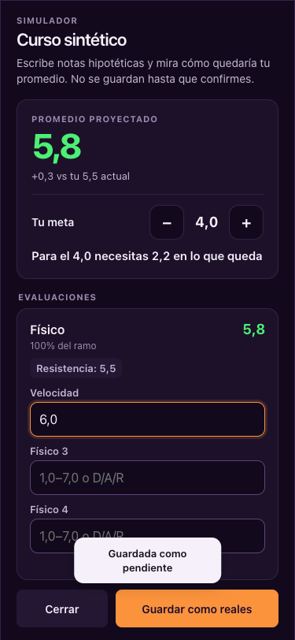
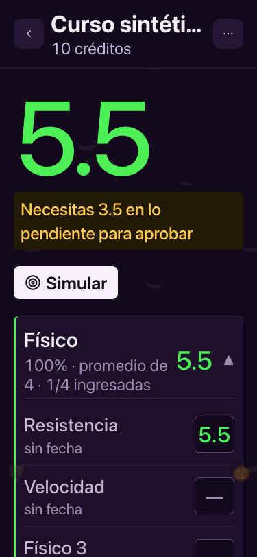
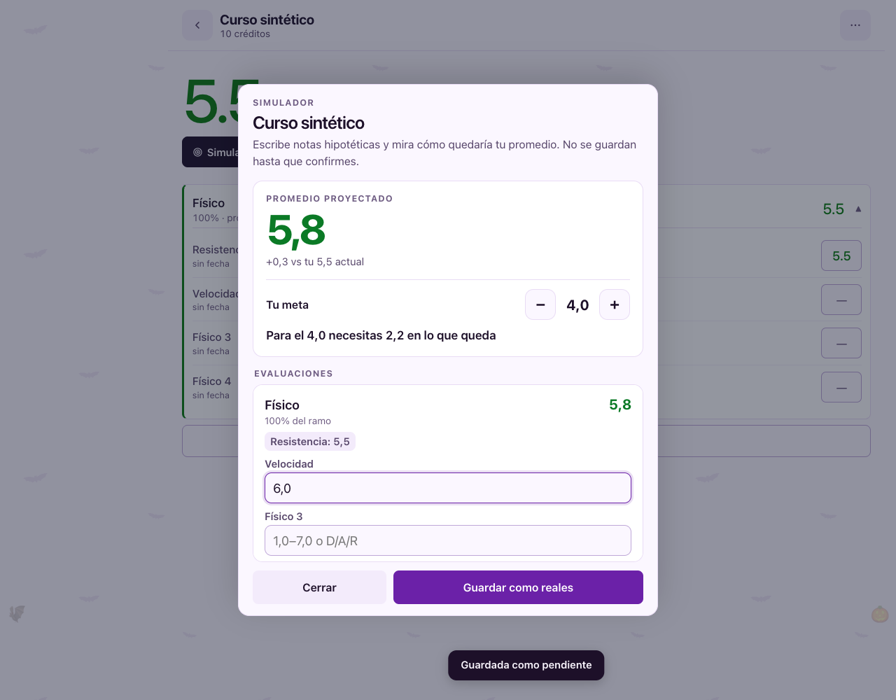
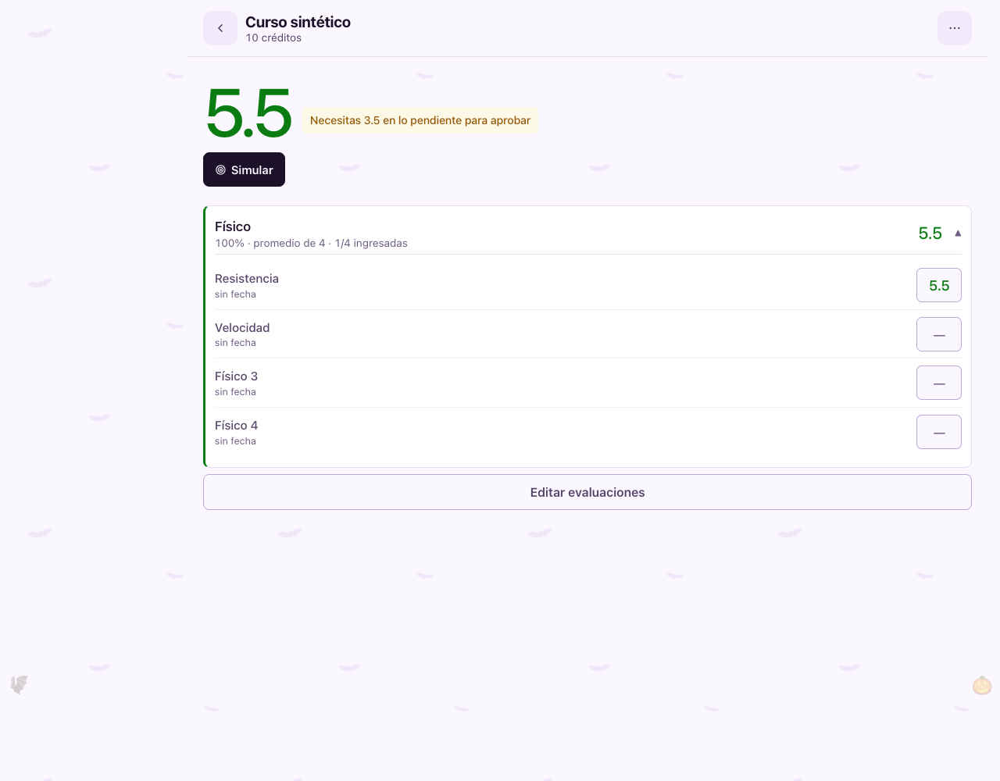
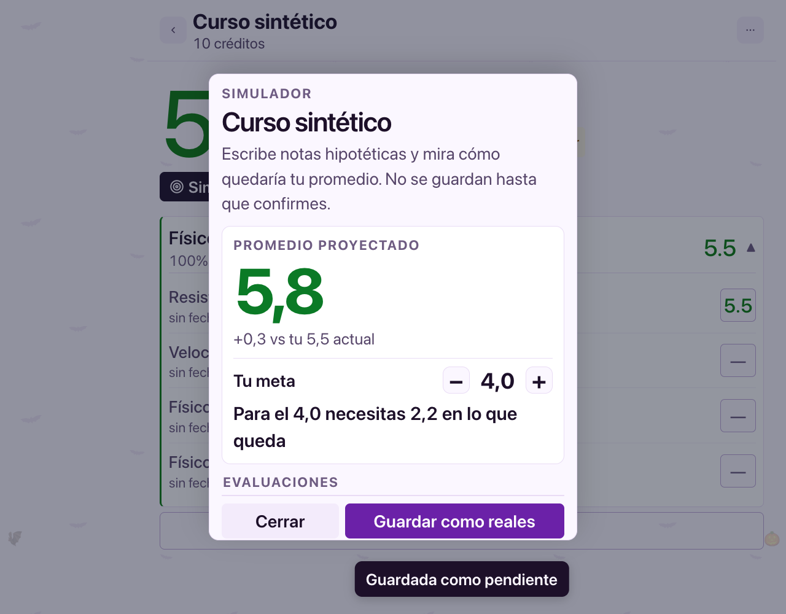
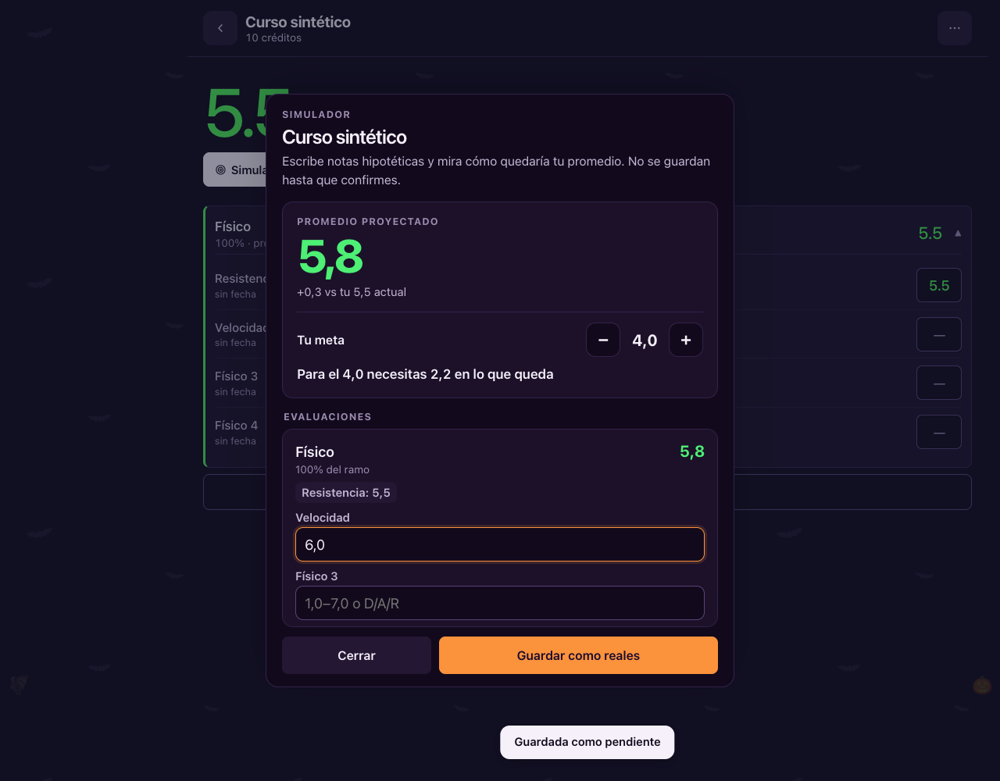
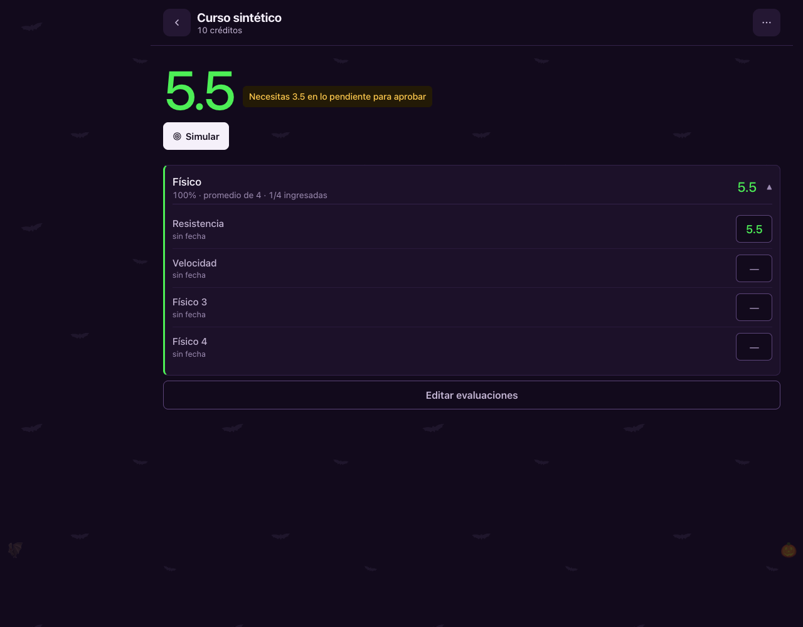
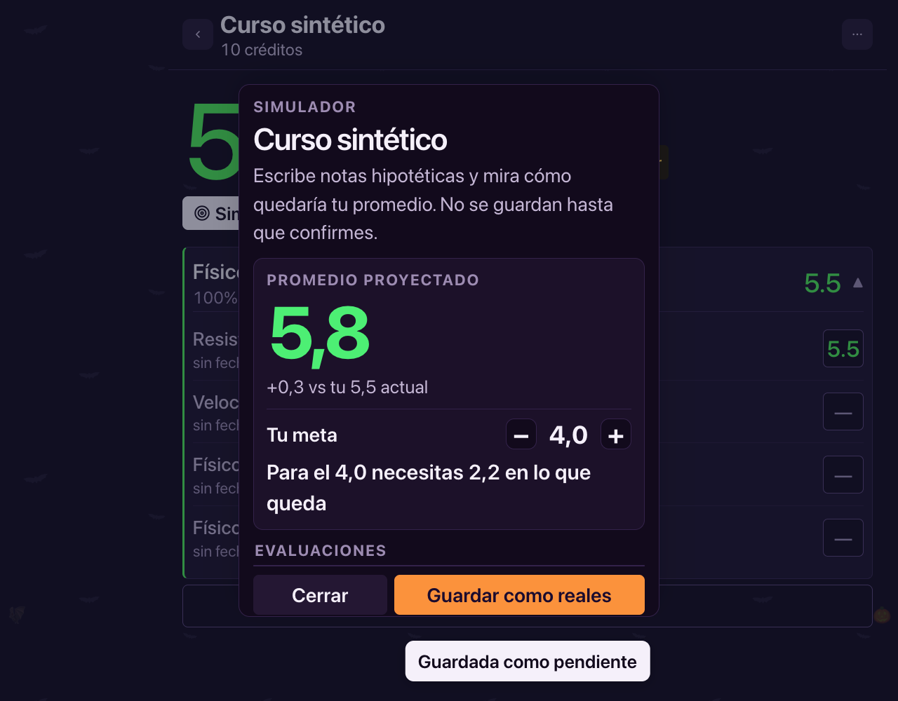

# Nombres de subnotas en ficha y simulador

Cuenta, ramo y calificaciones sintéticos. Se renombra Físico 1 a Resistencia y Físico 2 a Velocidad, y se comprueba también la recarga desde gradehub_v1. Conexiones externas y service worker bloqueados.

## 375 px · claro

### ficha

### simulador

### recarga

## 375 px · claro · texto 200%

### ficha

### simulador

### recarga

## 375 px · oscuro

### ficha

### simulador

### recarga

## 375 px · oscuro · texto 200%

### ficha

### simulador

### recarga

## 1280 px · claro

### ficha

### simulador

### recarga

## 1280 px · claro · texto 200%

### ficha

### simulador

### recarga

## 1280 px · oscuro

### ficha

### simulador

### recarga

## 1280 px · oscuro · texto 200%

### ficha

### simulador

### recarga

