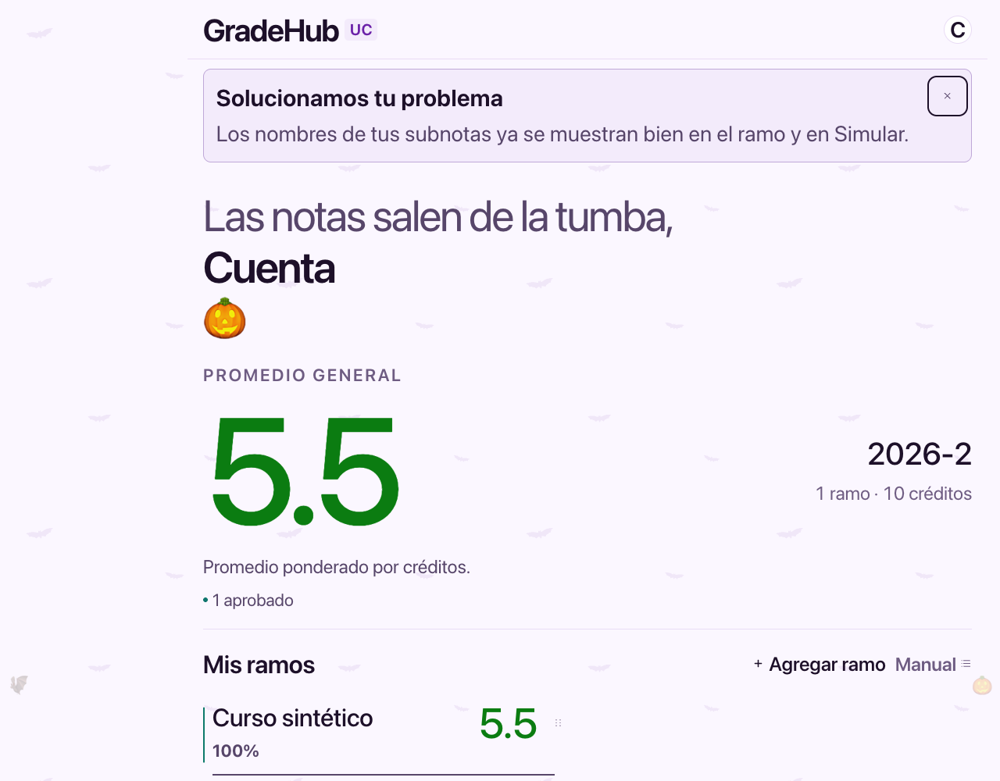
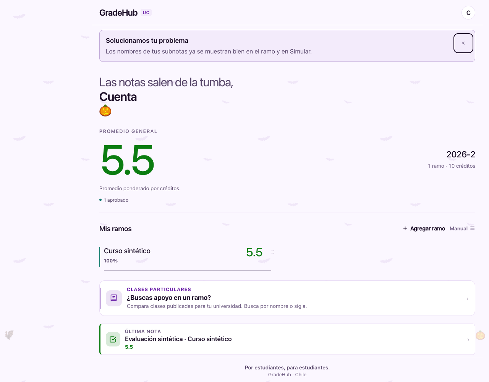
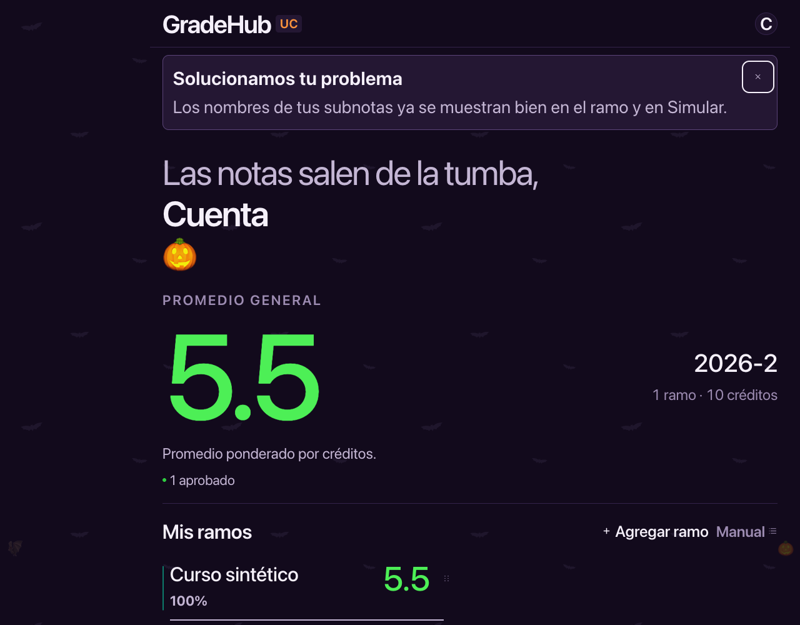
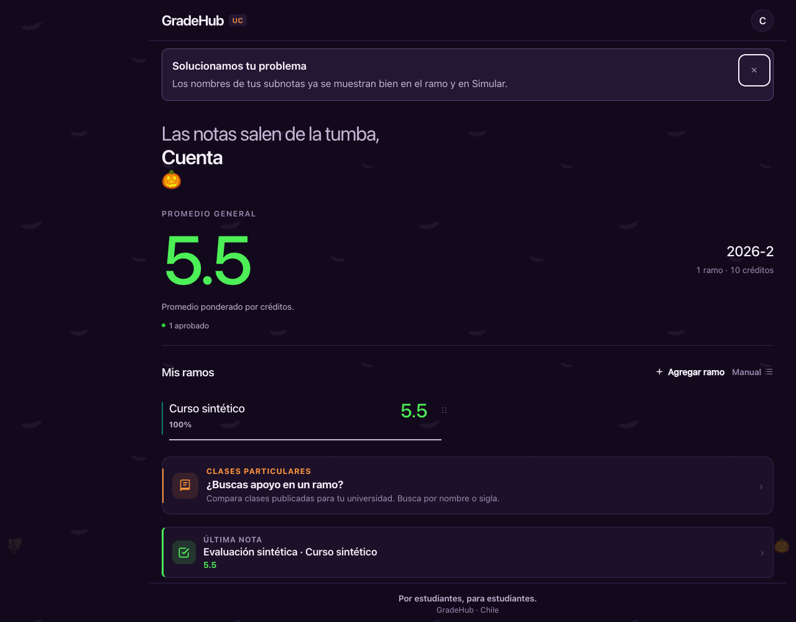
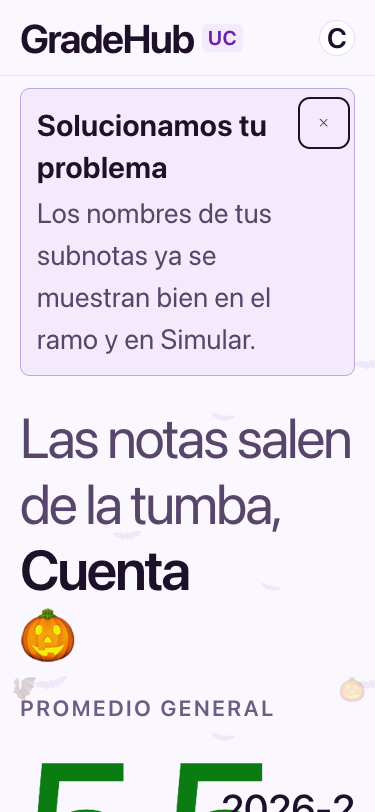
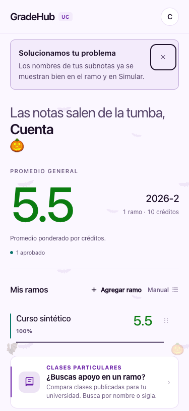
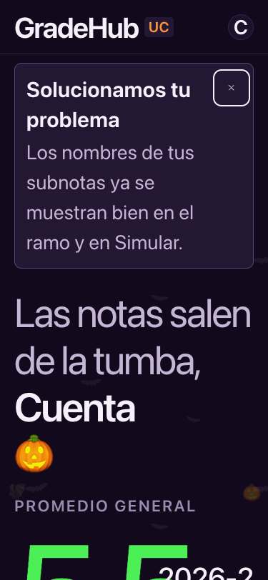
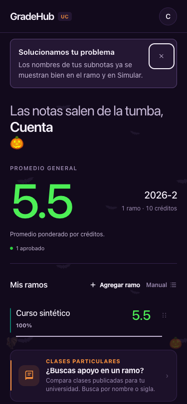

# Aviso privado de feedback solucionado

Solo datos sintéticos y respuestas de Supabase simuladas. No hay cuentas, comentarios ni notas reales.

Banner al principio de Inicio. Se conserva al recargar hasta cerrarlo; la lectura se guarda en el servidor. No se modifican las notas.

Las capturas muestran el foco de teclado en el cierre. El tema de Halloween proviene de main y no forma parte de este cambio.

Probado en 375/1280 px, claro/oscuro y texto normal/200%, sin service worker. Los controles tienen al menos 44 px; contraste mínimo del texto del banner: 7,27:1.

## 1280-claro-texto200

## 1280-claro

## 1280-oscuro-texto200

## 1280-oscuro

## 375-claro-texto200

## 375-claro

## 375-oscuro-texto200

## 375-oscuro

