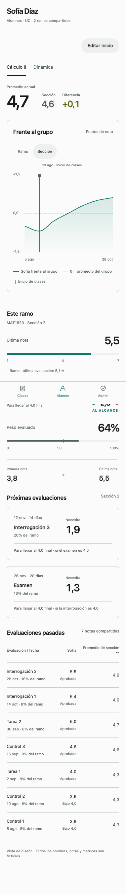
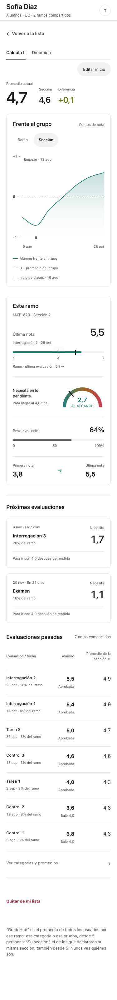
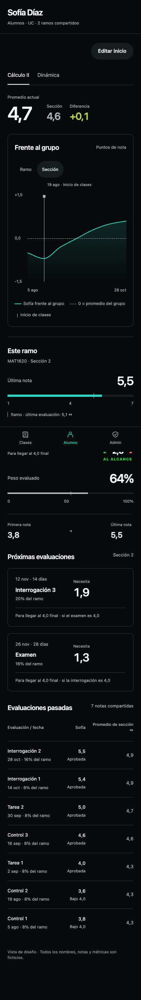
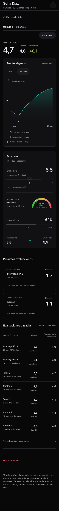
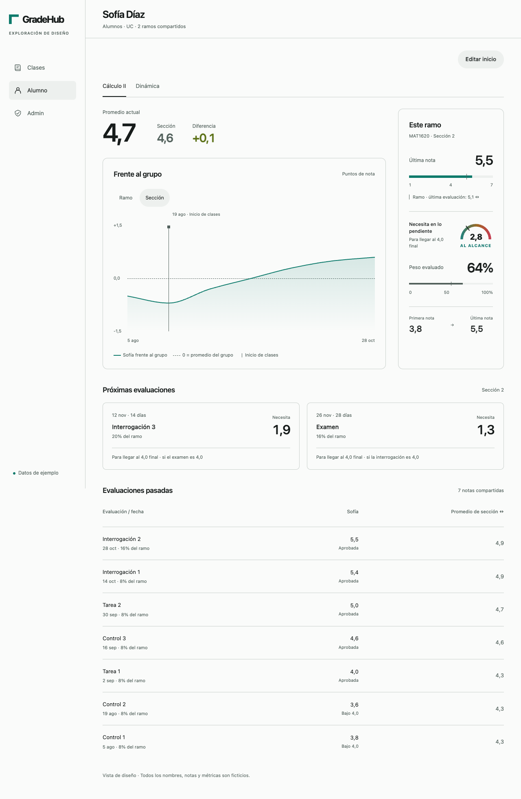
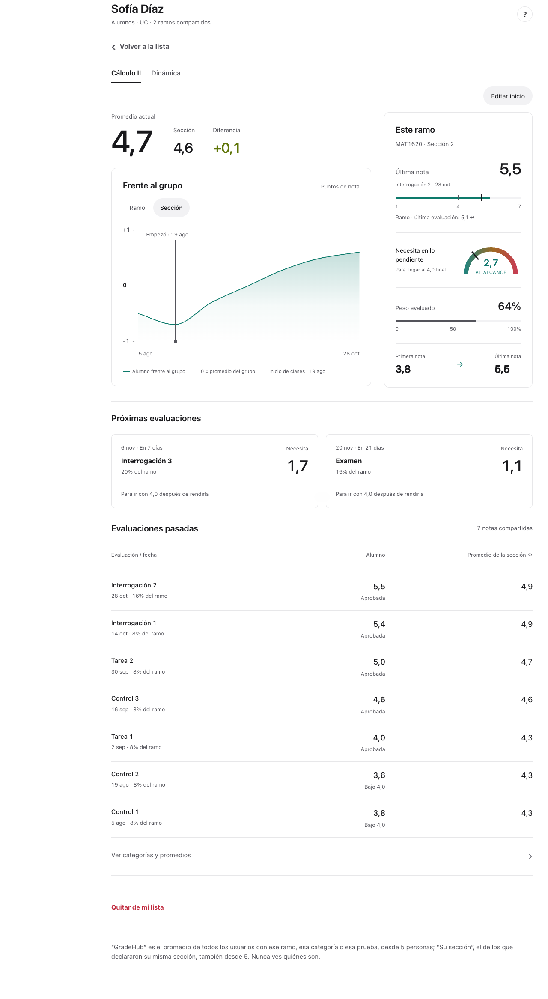
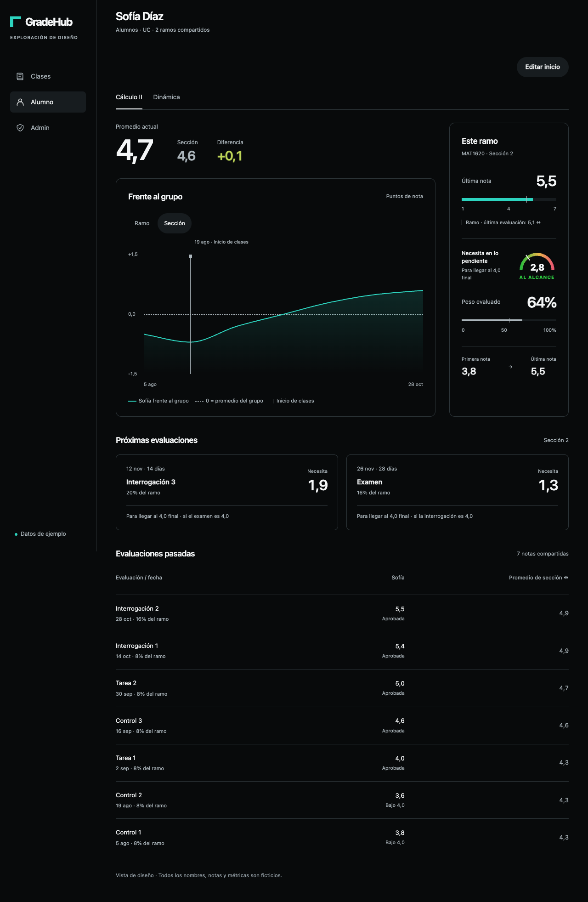
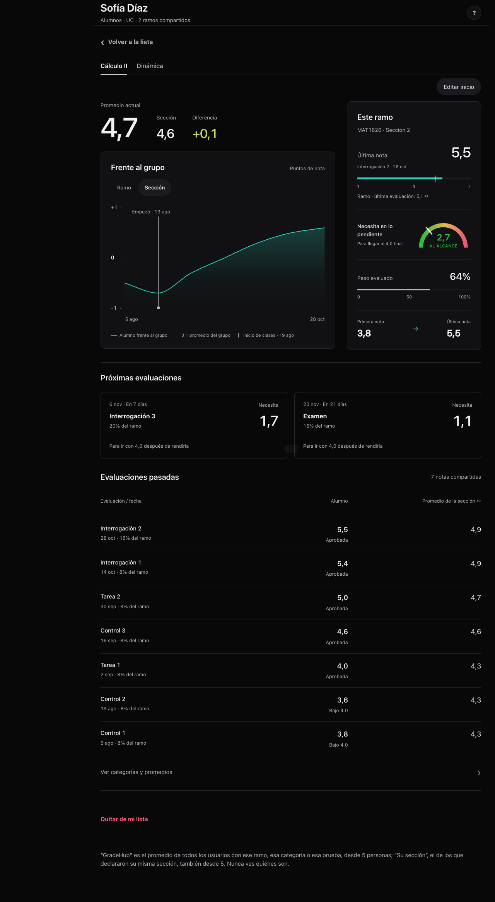

# Ficha del alumno · paridad con la maqueta aprobada

Primera entrega de tres, en la PR #908. Solo cambia la ficha que ve un profesor en Alumnos. Clases y Admin esperan a que esta PR esté mergeada. No incluye pantallas del estudiante.

Referencia: `~/dev/prototipos-gradehub/racional-whoop/alumno.html`, su `LEEME.md` y `fuentes/alumno.html`, `base.css`, `refinamientos.css`, `interacciones.js` y `vistas.json`. Las capturas de la maqueta se guardan aquí para que la revisión no dependa de esa ruta local.

## Cambios por impacto

| Problema en #907 | Cambio | Fundamento |
| --- | --- | --- |
| El promedio, el grupo y la diferencia estaban separados; gráfico y sidebar tenían números sueltos | Tres cifras en una fila y tarjeta «Este ramo» con última evaluación, medidor, peso evaluado y primera→última nota | HIG Charts: escala, referencia y valor juntos; Typography: jerarquía |
| El selector quedaba fuera del gráfico y se repetían datos de antes/ahora | Ramo/Sección dentro de «Frente al grupo», extremos de fechas, referencia horizontal discontinua y comienzo vertical continuo; sin recuentos Antes/Ahora | HIG Charts, Segmented controls |
| Las próximas eran filas sin peso ni contexto de fecha; las pasadas tenían columnas desalineadas | Tarjetas con fecha, días, peso y meta del motor; tabla con fecha·peso bajo el nombre, resultado bajo la nota y promedio a la derecha | HIG Charts y Typography |
| Encabezado duplicado, navegación con aspecto de recuadro y ramos como píldoras | Un título real con subtítulo, volver sin superficie propia, ramos subrayados y «Editar inicio» arriba | HIG Buttons y Accessibility |
| El número del medidor quedaba fuera del arco; la acción destructiva se mezclaba con el texto | Número y palabra dentro del arco, también con texto al 200%; quitar con espacio propio y la confirmación existente | HIG Accessibility, Buttons y Alerts |

## Diferencias deliberadas con la maqueta

- **Las metas no copian la fórmula de demostración.** La maqueta supone un 4,0 en otra evaluación pendiente; el motor actual `notaParaIrConCuatro` usa lo ya rendido más esta evaluación, sin suponer las notas posteriores. Se conserva ese resultado y la condición dice «Para ir con 4,0 después de rendirla». En el ejemplo compartido la próxima puede decir 1,7, aunque la maqueta diga otra cifra. El medidor global conserva la nota necesaria oficial: 2,7 frente al 2,8 aproximado de la maqueta, por el borde de redondeo del motor. Cambiarlo requeriría otro encargo de cálculo.
- **Privacidad y datos disponibles mandan.** No aparecen promedios de menos de cinco personas. Si no declaró sección se dice; no se muestra un cero. Si falló la comparación se informa el error, y si falta su función del servidor se muestra «Comparación no disponible por ahora». No se muestran mensajes técnicos al profesor.
- **Fechas reales.** La primera/última nota y el gráfico usan solo evaluaciones con fecha disponible. Las notas sin fecha siguen en la tabla. Si el inicio es anterior o posterior al rango, su fecha sigue en la leyenda pero no se dibuja una marca en una posición falsa. Cuando solo existe el día en que compartió notas se identifica como tal; «Editar inicio» conserva la función existente para corregirlo.
- **Sin ocultar ramos.** Con muchos ramos las pestañas se distribuyen en varias líneas; no se recortan ni se inventan promedios temporales.
- **Lectura en celular.** Los rótulos nuevos se mantienen en al menos 11 px; algunos de la maqueta eran de 10 px. Texto al 200% cambia la distribución del medidor y de las tarjetas para conservar el contenido.
- Se mantiene el detalle plegado «Ver categorías y promedios», para no retirar información existente; navegación, avatar y explicación de privacidad siguen siendo los de la app.

## Cuentas existentes, servidor y alcance

No hay SQL que aplicar ni migración. No cambia ninguna RPC, sus argumentos, permisos, MFA, cobros, registro de eventos ni datos compartidos. Se siguen usando las consultas actuales y la carga de secciones bajo demanda. El cambio de inicio y «Quitar de mi lista» siguen pasando por sus diálogos y funciones existentes. No se escribe nada al abrir la ficha o cambiar de ramo/grupo; la preferencia Ramo/Sección usa la clave local existente.

Los promedios, la nota necesaria, las ponderaciones y los resultados salen del motor vigente. Los porcentajes de cada evaluación usan `pesoEventoAgenda`; si el peso individual no es fijo se informa «Peso variable». Sin pauta evaluable no se afirma 100% de avance. La barra de avance es neutra, aun al 100%.

## HIG aplicadas

- [Charts](https://developer.apple.com/design/human-interface-guidelines/charts): escalas 1–7 y 0–100, referencias y leyenda, fechas reales y valores exactos al explorar.
- [Buttons](https://developer.apple.com/design/human-interface-guidelines/buttons): controles de al menos 44×44, navegación secundaria, estado presionado y foco visible.
- [Segmented controls](https://developer.apple.com/design/human-interface-guidelines/segmented-controls): Ramo/Sección junto al objeto que cambia, con selección explícita. La última evaluación mantiene su comparación independiente.
- [Accessibility](https://developer.apple.com/design/human-interface-guidelines/accessibility) y [Typography](https://developer.apple.com/design/human-interface-guidelines/typography): fuente del sistema, cifras tabulares, etiquetas accesibles, teclado, texto al 200%, contraste del eje Y ≥4,5 en ambos temas y movimiento reducido.
- [Alerts](https://developer.apple.com/design/human-interface-guidelines/alerts): quitar conserva confirmación y Cancelar; no ejecuta la operación al abrir el diálogo.

Se conserva el color gradual de diferencia solicitado por Lucas, además del signo numérico; no se usa el color como único canal.

## Validación

- `npm run build`, comprobaciones JS/CSS de AGENTS.md, `git diff --check` y `npm test` completo.
- Prueba de mecanismo ampliada en `tests/paneles-editorial.test.js`: promedio y metas del motor, supuesto de la meta, pesos fijos/variables, ausencia de notas, comparación protegida, fechas reales y distinción de error/ausencia de SQL.
- Chrome con la pantalla real `#screen-alumnos`, datos y RPC sintéticos locales, sin requests externos: 375/1280, claro/oscuro, normal/200%; última nota independiente, cambio de ramo/grupo, gráfico con Home/End, controles de 44 pt, contraste del eje, 20 ramos y Cancelar sin quitar.
- Medidor: 32 combinaciones de viewport, tema, texto normal/200% y metas 4,0 / 4,9 / 6,0 / No alcanza. Número y palabra contenidos en el SVG.
- Estados: cero alumnos, comparación sin SQL, error de comparación y error al cargar alumnos. Un error no se presenta como cero.

## Maqueta y app, lado a lado

Todas las personas, notas y pautas de estas capturas son inventadas. La app usa los mismos valores base de la maqueta; las diferencias de metas documentadas arriba son las del motor real. Las capturas completas de la app expanden únicamente su contenedor de scroll para mostrar toda la ficha, conservando el DOM y el encabezado reales.

### 375 px · claro

| Maqueta aprobada | App |
| --- | --- |
|  |  |

### 375 px · oscuro

| Maqueta aprobada | App |
| --- | --- |
|  |  |

### 1280 px · claro

| Maqueta aprobada | App |
| --- | --- |
|  |  |

### 1280 px · oscuro

| Maqueta aprobada | App |
| --- | --- |
|  |  |

### Texto grande y estados

[Texto al 200%](app-375-oscuro-texto200.png) · [Cero alumnos](estado-vacio.png) · [Comparación sin SQL](estado-sinSQL.png) · [Error de comparación](estado-errorComparacion.png) · [Error de carga](estado-error.png)
