# Inicio del estudiante — maqueta aprobada, PR 1 de 5

Solo se lleva a la app la parte de Inicio. Agenda, ficha, ingreso de notas y gráfico de Estadísticas siguen en sus PRs posteriores, en el orden acordado con Lucas. La maqueta autocontenida continúa disponible en su worktree de revisión.

## Qué cambia y por qué

| Impacto | Antes | Ahora | Regla aplicada |
| --- | --- | --- | --- |
| Alto | La oferta de clases aparecía antes de la situación académica, con tarjetas de distinto estilo. | Después del listado: próxima evaluación y riesgo con el mismo formato, luego simular el semestre y finalmente una oferta de clases sin aspecto de advertencia. | [HIG Buttons](https://developer.apple.com/design/human-interface-guidelines/buttons): jerarquía y acciones reconocibles. Orden aprobado en la maqueta. |
| Alto | El promedio del semestre usaba el semáforo y podía volver a ese color durante una animación. | Cifra grande en el acento del tema, sin tarjeta envolvente. Se conservan el semestre y los créditos a la derecha, la comparación con el semestre anterior y los puntos de estado de los ramos. El color sigue siendo el acento al animarse. Con texto al 200%, el contexto baja para evitar el recorte; a tamaño normal sigue a la derecha. | [HIG Color](https://developer.apple.com/design/human-interface-guidelines/color): uso consistente del color; semáforo académico de AGENTS.md. |
| Medio | La evaluación y el ramo iban juntos y el plazo quedaba chico. | Evaluación y ramo a la izquierda; plazo y fecha a la derecha. El riesgo usa la misma distribución, con su promedio y su color académico. | [HIG Typography](https://developer.apple.com/design/human-interface-guidelines/typography): jerarquía y fuente del sistema; cifras con `tabular-nums`. |
| Medio | Las tarjetas académicas eran `div` con comportamiento de botón. | Botones nativos, con foco visible y objetivos mayores de 44 pt. | [HIG Accessibility](https://developer.apple.com/design/human-interface-guidelines/accessibility) y Buttons: teclado, contraste, tamaño táctil y texto ampliado. |
| Bajo | Se repetía “Promedio ponderado por créditos”. | Se oculta esa aclaración rutinaria. Si faltan créditos se conserva la explicación de promedio simple; el detalle del cálculo también sigue disponible al tocar el promedio. | Corrección explícita de Lucas en la maqueta; se mantiene la explicación cuando falta información académica. |

Las filas del listado de ramos no cambian: se comparó su HTML completo antes/después y fue idéntico en las cuatro combinaciones de ancho y modo. No se modifica el motor, la selección de la próxima evaluación (`nextExam`), las reglas académicas ni la medición.

## Capturas sintéticas de antes y después

Mismo estado inventado, reloj fijo al 30 de octubre de 2026. Sin Halloween ni acceso a datos de producción. Los nombres, pautas y notas son muestras de prueba; no representan programas oficiales.

### Resumen y listado

| Pantalla | Antes | Después |
| --- | --- | --- |
| 375 px · claro | 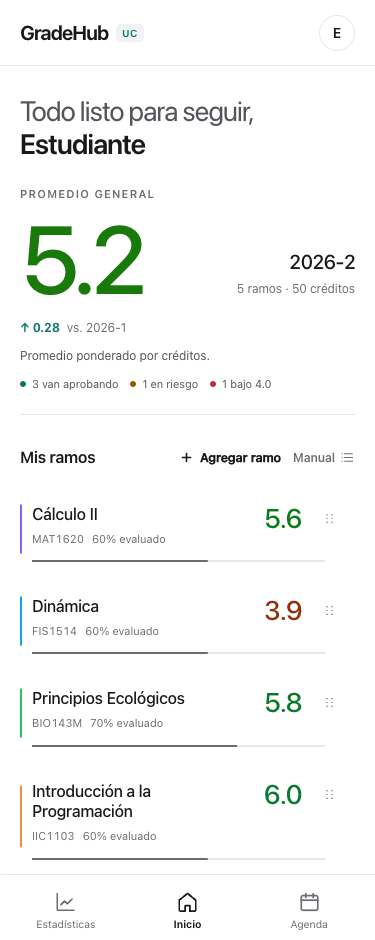 | 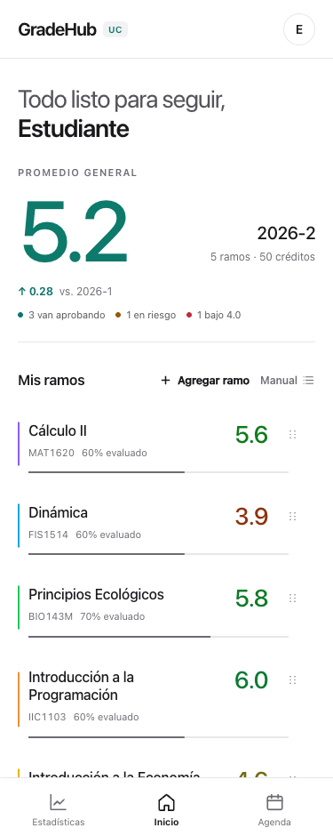 |
| 375 px · oscuro | 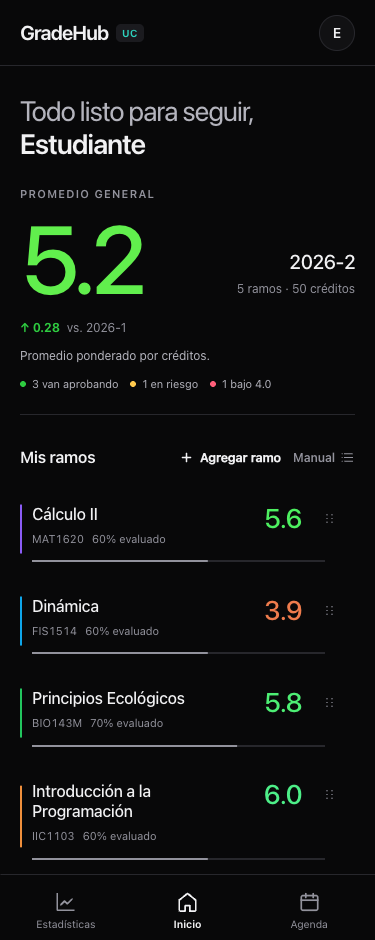 | 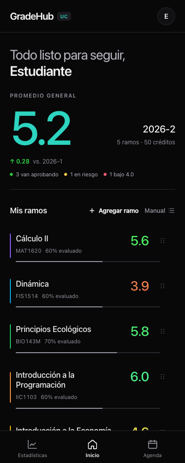 |
| 1280 px · claro | 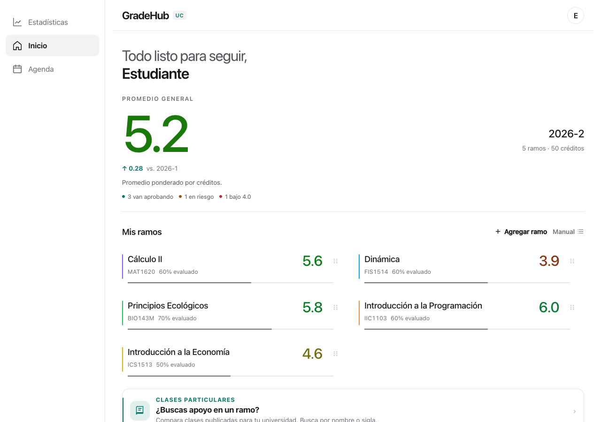 | 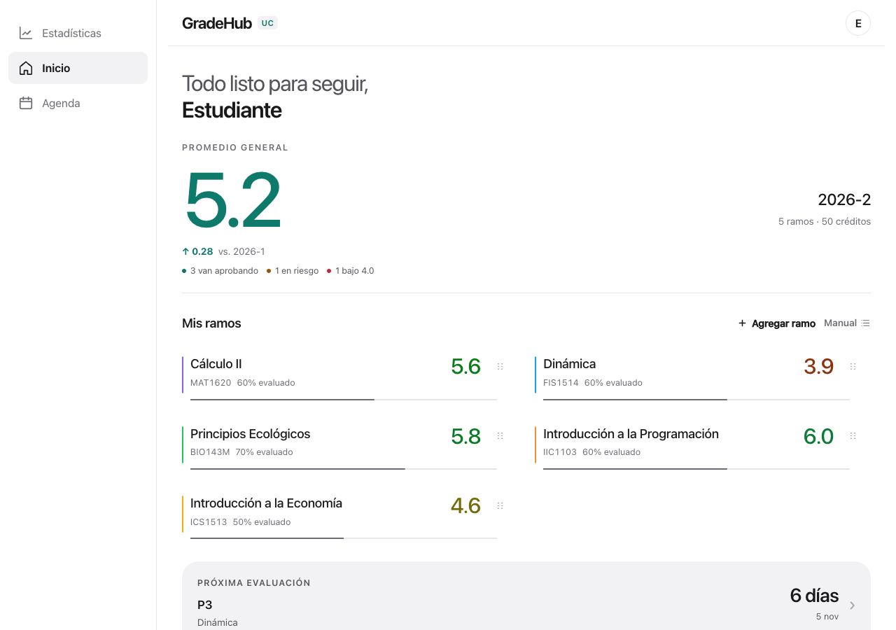 |
| 1280 px · oscuro | 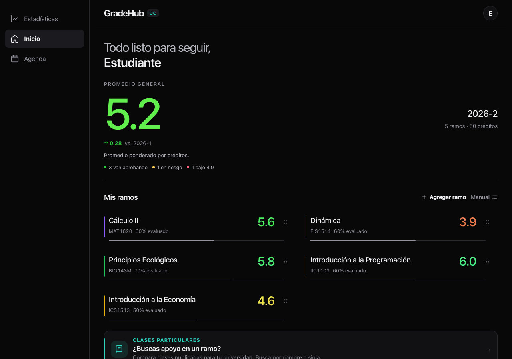 | 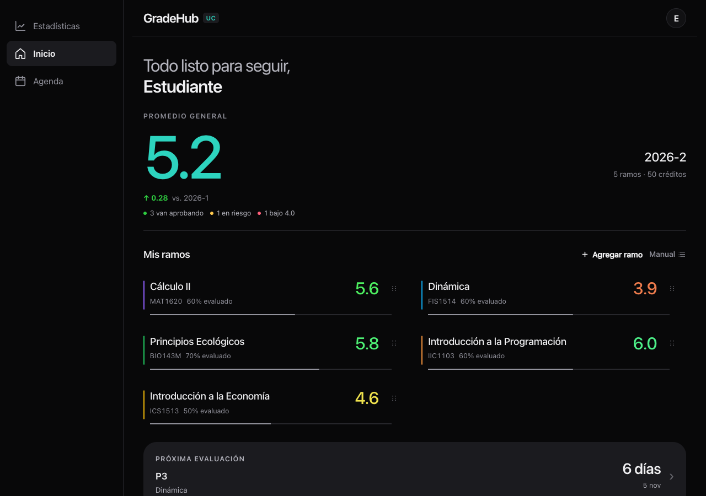 |

### Bloques bajo el listado

| Pantalla | Antes | Después |
| --- | --- | --- |
| 375 px · claro | 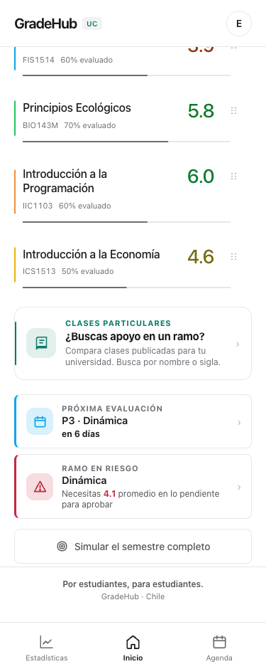 | 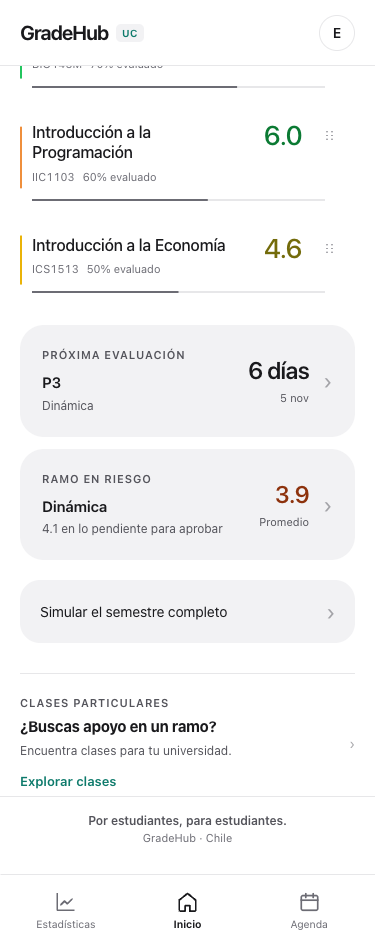 |
| 375 px · oscuro | 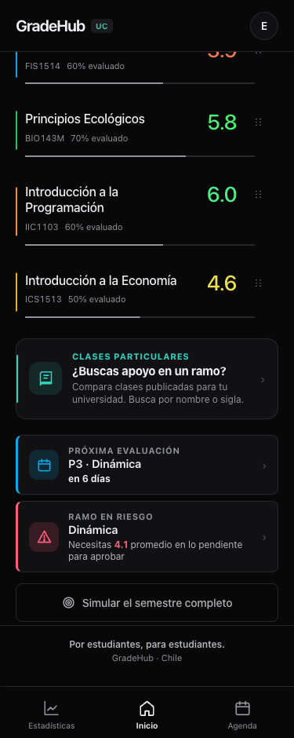 | 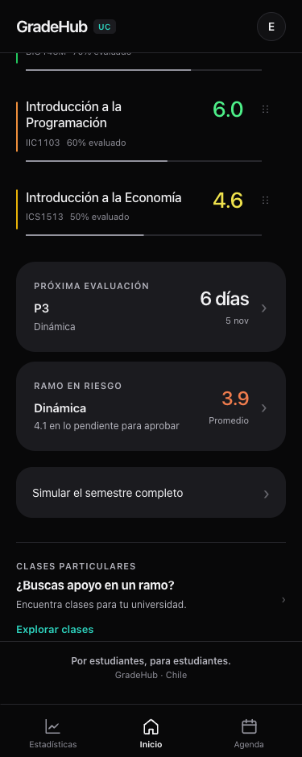 |
| 1280 px · claro | 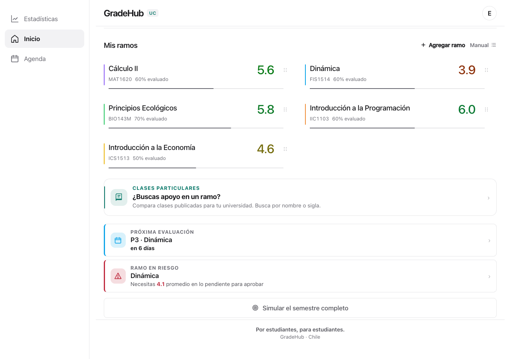 | 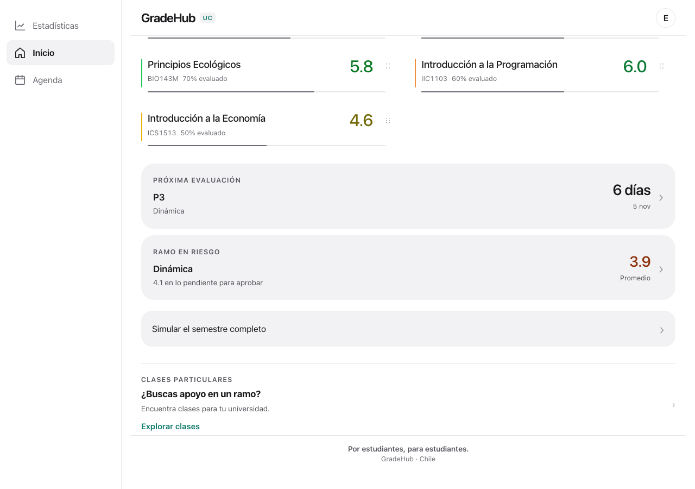 |
| 1280 px · oscuro | 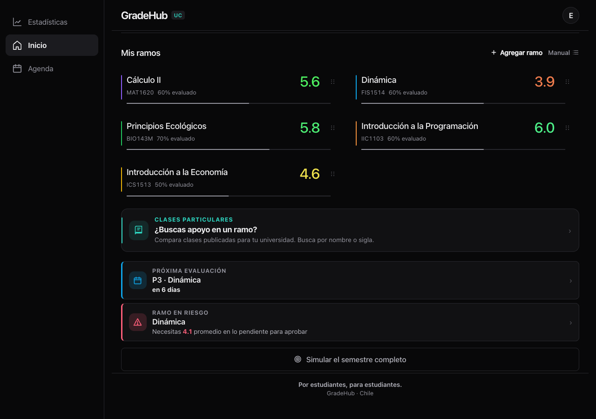 | 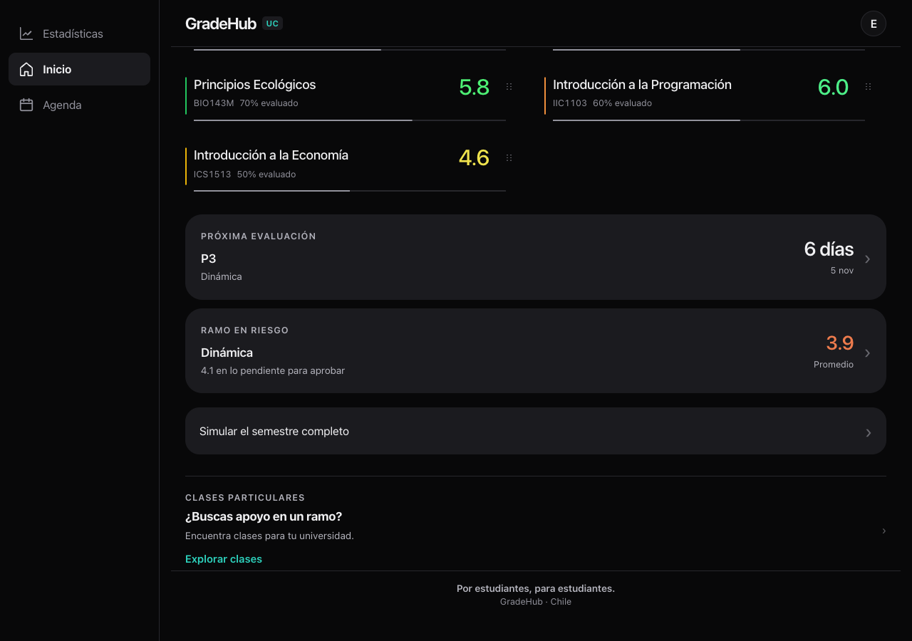 |

## Cuentas existentes

- **Sin ramos:** conserva la invitación a agregar el primero, sin tarjetas académicas antiguas ni simulador global. [Captura](cuenta-sin-ramos-375-oscuro.png).
- **Notas sin fecha:** siguen contando en el promedio. No se inventan fechas ni se ocultan notas antiguas; si no hay próxima evaluación ni riesgo se conserva la tarjeta de última nota. [Captura](cuenta-sin-fechas-375-oscuro.png).
- **Un ramo que ya no se puede aprobar:** muestra “Ya no alcanza” y su promedio. No propone una nota imposible. [Captura](cuenta-imposible-375-oscuro.png).
- **Créditos faltantes:** el promedio sigue siendo simple según el motor y mantiene su explicación. No se rellena ningún crédito.

No hay SQL que aplicar, migración ni cambios de `gradehub_v1`. No se escriben o transforman datos guardados. La comparación conserva verde al subir y rojo al bajar; los puntos del semáforo siguen describiendo los ramos.

## Validación

- `npm run build`; comprobación de sintaxis de `data.js` y `app.js`; CSS con llaves equilibradas.
- `npm test` completo: 365 archivos de tests.
- Pruebas de navegador con renderizadores reales, datos sintéticos y red externa bloqueada: 375/1280 px, claro/oscuro, texto al 200%, controles de 44 pt, foco y activación con Enter de las tarjetas, simulación y catálogo.
- Contraste mínimo de texto medido en los bloques afectados: **4,82:1**, incluyendo Neutro, Papel y Pizarra en ambos modos.
- `tests/proxima-evaluacion.test.js` actualiza tres expectativas de presentación: nombre y ramo separados, plazo “2 días” y nombre de categoría sin el separador anterior. Se conservan los casos de mecanismo de fechas, casillas pendientes y eximición; se agregan verificaciones del orden, color, datos antiguos y estado imposible.

No se detectó un conflicto entre las HIG y la dirección aprobada que requiera otra decisión de diseño.
