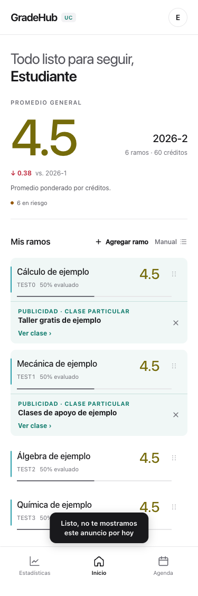
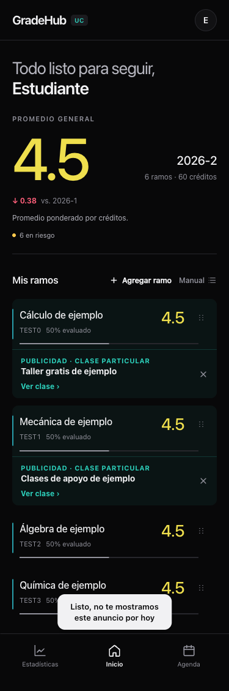
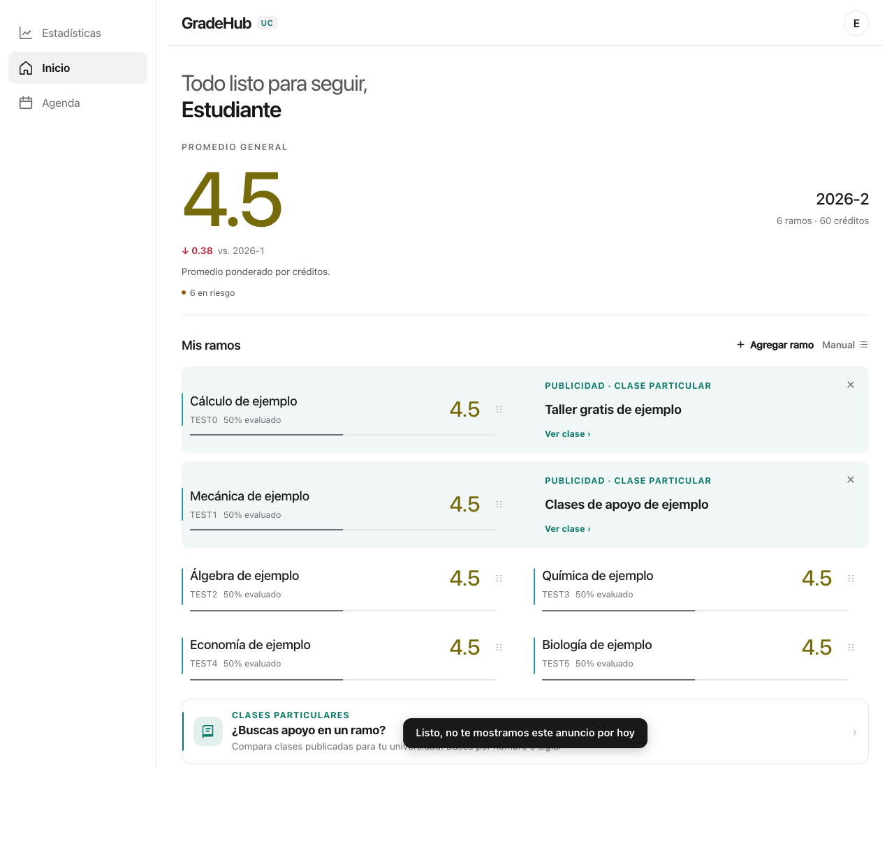
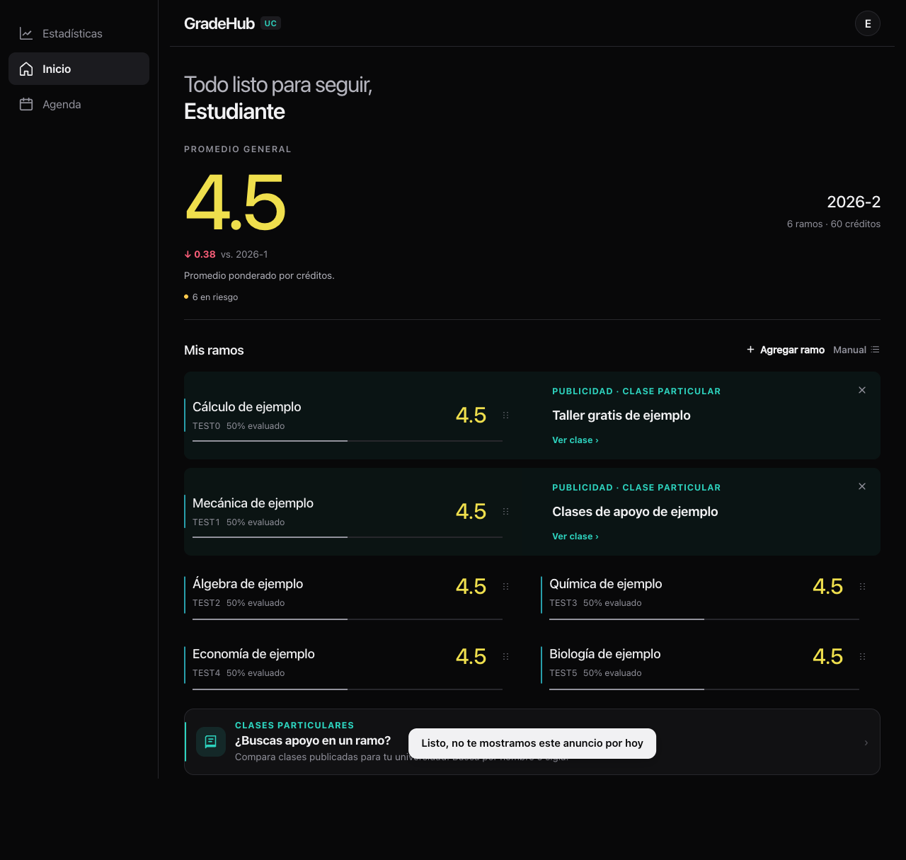

# Anuncios de hasta dos ramos · 2026-10-31

Escenarios sintéticos, sin conexión a Supabase ni usuarios reales.

- Cada ramo empieza su vuelta por los anuncios con precio y luego los gratis. Con uno de cada uno: pagado → gratis → pagado entre aperturas, sin tocar la X.
- Cada ramo avanza cuando le toca mostrarse. Con más de dos ramos elegibles se alternan grupos de hasta dos; no se cambia el orden guardado de los ramos.
- La X oculta ese anuncio hasta la próxima medianoche de Chile, mediante las RPC existentes, y deja una pausa de 30 segundos en su ramo. El otro ramo conserva su turno. La pausa local también se conserva al reabrir durante esos 30 segundos.
- Una carga de página o regresar desde segundo plano cuenta como apertura. Navegar entre pestañas de GradeHub, repintar por una nota o dar foco a la ventana conserva la selección.
- Las campañas, el motor, las métricas, sus umbrales y los públicos configurados no cambian. No requiere SQL.

## Capturas

Después de cerrar el primer pagado y esperar la pausa: el primer ramo muestra su gratis y el segundo conserva el pagado. El aviso de cierre que aparece abajo es el toast existente.

| Ancho | Claro | Oscuro |
|---|---|---|
| 375 px |  |  |
| 1280 px |  |  |

## Validación

`tests/recomendaciones-dos-ramos.test.js` usa pautas escritas en el fixture, sin tomar datos del catálogo. Cubre alternancia, máximo de dos ramos, rotación con cantidades pares e impares, cierres locales/remotos, medianoche, aislamiento por cuenta, disco bloqueado y regreso desde segundo plano. Se mantienen además los tests de medición, precarga, reintento y cierres con PGlite.

Chrome: 120 combinaciones de posición (15 pares de seis ramos × cuatro anchos × dos temas), sin superposición ni desborde a 375, 820, 1280 y 1600 px. Texto al 150%, cierre y reemplazo con reloj controlado, foco conservado en el anuncio del otro ramo y reordenamiento manual sin posiciones trabadas.

HIG: [Layout](https://developer.apple.com/design/human-interface-guidelines/layout) (agrupación por ramo y adaptación) y [Buttons](https://developer.apple.com/design/human-interface-guidelines/buttons) (X de 44×44 pt, etiquetas accesibles y foco). Se conserva el estilo existente y `prefers-reduced-motion`.
